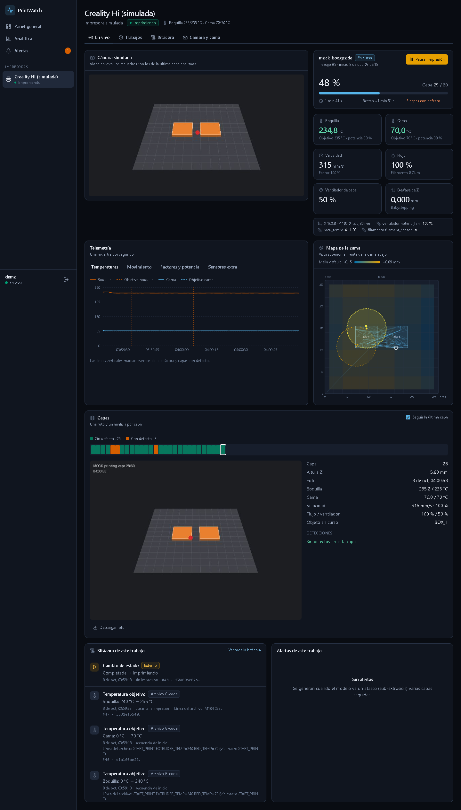

# PrintWatch — Detección de fallos en impresión 3D

Sistema de monitoreo en tiempo real de impresoras 3D (FDM) que fotografía cada capa, detecta defectos con un modelo de visión por computador (YOLO11s exportado a ONNX) y avisa al operador mediante una interfaz web. Puede pausar la impresión automáticamente cuando detecta *spaghetti* en capas consecutivas.

Además registra la telemetría de la impresora una vez por segundo (temperaturas, velocidad, flujo, ventiladores, posición), lleva una bitácora de cada cambio durante la impresión con quién lo hizo según la evidencia disponible (PrintWatch, la consola, el archivo G-code, la propia impresora o alguien sin identificar) protegida con una cadena de hashes, y ubica los defectos sobre la cama en milímetros a partir de una calibración de la cámara. Con la impresora solo se habla en modo lectura, salvo la pausa automática.

**Autores:** Samuel Rodriguez y Adrian Stiven Meneses Ávila

**Defectos que detecta (6 clases):** `spaghetti`, `warping`, `stringing`, `layer_shift`, `under_extrusion`, `blob_over_extrusion`.

## Arquitectura

```
Impresora (Moonraker / OctoPrint)
        │  WebSocket de solo lectura: estado, capa, temperaturas, posición, comandos
        ▼
   backend ──Redis──► capture ──► foto de la capa ──► Redis (captures:pending)
   (FastAPI)                                                  │
        │  ▲                                                  ▼
        │  │                                           inference-worker
        │  Postgres ◄──────── detecciones + cajas ◄─── (ONNX Runtime, YOLO11s)
        │     ▲
        └─────┘  trabajos, capas, telemetría 1 Hz, bitácora con hashes, calibración de cámara
        │
        ▼
   frontend (React) ◄── REST + WebSocket: capas, alertas, telemetría y eventos en vivo
```

## Registro de recursos del proyecto

### Código fuente

| Recurso | Ubicación | Descripción | Propósito | Estado |
|---|---|---|---|---|
| Backend / API | [`backend/`](backend/) | FastAPI + SQLAlchemy async + Alembic. Autenticación JWT, impresoras, cámaras, trabajos de impresión, capas, detecciones, alertas, WebSocket, listeners de Moonraker y OctoPrint, pausa automática. Telemetría por segundo, bitácora de eventos con atribución y cadena de hashes, mapa de la cama (calibración de cámara por homografía) y analítica. | Núcleo del sistema: expone la API REST/WebSocket y coordina el resto de servicios. | Detección y pausa verificadas con hardware real (Creality Hi); telemetría, bitácora y mapa de la cama probados con la impresora simulada, pendientes de una impresión real |
| Captura de imágenes | [`capture/`](capture/) | Servicio que fotografía cada capa desde la cámara (USB, RTSP, MJPEG o sintética) y publica la tarea de inferencia. Incluye la heurística de color y el stream en vivo. | Obtener las imágenes de cada capa durante la impresión. | Funcional |
| Inferencia | [`inference/`](inference/) | Worker que ejecuta el modelo ONNX sobre las capturas y guarda detecciones (clases, confianza, cajas) en Postgres. | Detección de defectos en producción. | Funcional — modelo `yolo11s-trained-v1-fp32` |
| Frontend | [`frontend/`](frontend/) | React 18 + TypeScript + Vite + Tailwind + Recharts. Panel general, impresión en vivo (video, telemetría, mapa de la cama, capas), historial con repetición de cada trabajo, bitácora con verificación de integridad, analítica, calibración de la cámara y centro de alertas. Se adapta al celular. | Interfaz del operador. | Rediseñado; probado con la impresora simulada |
| Infraestructura | [`infra/`](infra/) | `docker-compose.yml` (Postgres 16, Redis 7, backend, inference-worker) y `docker-compose.dev.yml` (recarga en caliente). | Despliegue reproducible. | Funcional |
| Scripts de apoyo | [`backend/scripts/`](backend/scripts/) | `create_user.py`, `mark_layers.py` (disparo manual de capas, plan B), `mock_octoprint.py` y `mock_moonraker.py` (impresoras simuladas; la segunda imita la Creality Hi con cámara simulada), `moonraker_discovery.py` (inventario de solo lectura de lo que expone la impresora), `demo_environment.py` (modo demostración). | Administración, demo y pruebas sin hardware. | Funcional |

### Entrenamiento del modelo (notebooks y scripts)

| Recurso | Ubicación | Descripción | Propósito | Estado |
|---|---|---|---|---|
| Notebook de entrenamiento | [`inference/training/colab_train.ipynb`](inference/training/colab_train.ipynb) | Descarga de datasets, conversión, split, *bake-off* de arquitecturas, entrenamiento final, validación, exportación a ONNX (FP32 e INT8), calibración de umbral y diagnóstico. Pensado para Google Colab con GPU. | Reproducir el entrenamiento completo. | Completado (corrida del 2026-09-18) |
| Configuración experimental | [`inference/training/configs/train_config.yaml`](inference/training/configs/train_config.yaml) | Única fuente de hiperparámetros: clases, split 70/15/15 por secuencia, bake-off (`yolo11s` vs `yolov8n`), entrenamiento final (100 épocas, 640 px). | Trazabilidad de los experimentos. | Vigente |
| Definición del dataset | [`inference/training/datasets/dataset.yaml`](inference/training/datasets/dataset.yaml) | Rutas de train/val/test y orden de las 6 clases (define el índice de clase en todo el sistema). | Formato Ultralytics del dataset. | Vigente |
| Preprocesamiento | [`inference/training/scripts/convert_to_yolo.py`](inference/training/scripts/convert_to_yolo.py), [`merge_datasets.py`](inference/training/scripts/merge_datasets.py) | Mapeo de clases de cada dataset de origen a las 6 clases del proyecto, conversión a YOLO y *split* por secuencia. | Unificar datasets de distintas fuentes. | Completado |
| Evaluación | [`calibrate_thresholds.py`](inference/training/scripts/calibrate_thresholds.py), [`inspect_false_positives.py`](inference/training/scripts/inspect_false_positives.py) | Calibración del umbral de confianza (precisión/recall por clase) y diagnóstico de falsos positivos/negativos. | Elegir el umbral y entender las clases débiles. | Completado |
| Guía de entrenamiento | [`inference/training/README.md`](inference/training/README.md) | Procedimiento paso a paso, resultados de calibración y diagnóstico de `blob_over_extrusion`. | Documentación de soporte. | Vigente |

### Modelos entrenados

| Recurso | Ubicación | Descripción | Versión | Estado |
|---|---|---|---|---|
| Modelo FP32 (desplegado) | [`inference/models/best_fp32.onnx`](inference/models/best_fp32.onnx) (36 MB) | YOLO11s entrenado, exportado a ONNX en precisión completa. Es el que usa el worker. | `yolo11s-trained-v1-fp32` | En uso |
| Modelo INT8 | [`inference/models/best_int8.onnx`](inference/models/best_int8.onnx) (9,5 MB) | Versión cuantizada del mismo modelo. | `yolo11s-trained-v1-int8` | Disponible, no desplegado |

### Datasets

Los datasets **no se versionan en este repositorio** (son miles de imágenes de terceros); solo se conserva la estructura de carpetas. Se descargan con el paquete `roboflow` desde el notebook de entrenamiento (requiere API key propia de Roboflow, que el notebook solicita en tiempo de ejecución y no se guarda).

| Dataset (Roboflow Universe) | Imágenes | Clases aportadas |
|---|---|---|
| "3D PRINT DEFECT DETECTION" — `3d-print-defect-detection-6fcmi-drylp` v1 | 3612 | blobs, crack, Layer_shifting, spaghetti, stringing, Warping |
| "3d print fail detection" — `3d-print-fail-detection-jckut` v1 | 1002 | crack, spaghetti, stringing |
| "Under Extrusion" — `under-extrusion-pf0uy-nlyil` v1 | 999 | Under Extrusion |

- **Dataset procesado:** se genera con el notebook (`inference/training/datasets/processed/`, 841 imágenes en el conjunto de prueba) y se persiste en Google Drive como `processed.tar`.
- **Fotos capturadas por el sistema** (`storage/snapshots/`): se generan en operación y no se versionan.

### Resultados experimentales

| Recurso | Ubicación | Contenido |
|---|---|---|
| Métricas del modelo FP32 | [`inference/models/best_fp32.metrics.json`](inference/models/best_fp32.metrics.json) | Calibración sobre el *test set* (841 imágenes): precisión/recall por clase a nivel imagen con umbral 0,25. |
| Métricas del modelo INT8 | [`inference/models/best_int8.metrics.json`](inference/models/best_int8.metrics.json) | Validación Ultralytics: mAP50, mAP50-95, precisión y recall por clase. |
| Diagnóstico de `blob_over_extrusion` | [`inference/training/diagnosis/blob_over_extrusion.diagnosis_summary.json`](inference/training/diagnosis/blob_over_extrusion.diagnosis_summary.json) | Clasificación de falsos positivos y blobs no detectados. |
| Limitaciones conocidas | [`docs/KNOWN_LIMITATIONS.md`](docs/KNOWN_LIMITATIONS.md) | Comportamiento observado con hardware real, casos límite y riesgos. |
| Avance de telemetría, bitácora y mapa de la cama | [`docs/PROGRESO_TELEMETRIA.md`](docs/PROGRESO_TELEMETRIA.md) | Lo hecho por fases, decisiones tomadas, mediciones de consumo y lo que falta probar con la impresora. |
| Descubrimiento de la impresora | [`docs/moonraker_discovery/`](docs/moonraker_discovery/) | Qué expone la Creality Hi por Moonraker (objetos, macros, configuración) y el análisis del incidente de reanudación. |

**Resumen de resultados** (modelo FP32, umbral global 0,25, nivel imagen, *test set* de Roboflow):

| Clase | Precisión | Recall |
|---|---|---|
| **General (`has_defect`)** | **0,997** | **0,921** |
| spaghetti | 0,963 | 0,975 |
| warping | 0,988 | 0,988 |
| stringing | 0,977 | 0,959 |
| layer_shift | 1,000 | 1,000 |
| under_extrusion | 0,919 | 0,685 |
| blob_over_extrusion | 0,562 | 0,529 |

`blob_over_extrusion` es la clase débil del modelo y se trata como informativa en el sistema. Estas métricas se midieron sobre fotos de Roboflow Universe; la validación con la cámara e impresora reales del proyecto está pendiente. Detalles en [`docs/KNOWN_LIMITATIONS.md`](docs/KNOWN_LIMITATIONS.md) y en la guía de entrenamiento.

## Cómo ejecutar

Requisitos: Docker (Postgres y Redis), Python 3.12, Node.js (frontend).

1. **Variables de entorno:** copiar `.env.example` a `.env` y completar `JWT_SECRET_KEY` y `FIELD_ENCRYPTION_KEY` (el comando para generar la segunda está comentado en el propio archivo). Copiar también `frontend/.env.example` a `frontend/.env`.
2. **Postgres y Redis (y, opcionalmente, backend e inferencia en contenedores):**
   ```bash
   docker compose -f infra/docker-compose.yml --env-file .env up -d                  # solo Postgres y Redis
   docker compose -f infra/docker-compose.yml --env-file .env --profile full up -d --build   # todo en contenedores
   ```
3. **Migraciones y primer usuario** (desde `backend/`, con sus dependencias instaladas):
   ```bash
   alembic upgrade head
   python scripts/create_user.py
   ```
4. **Servicios en modo nativo** (alternativa a `--profile full`): backend (`uvicorn app.main:app --port 8000` desde `backend/`), inferencia (`python main.py` desde `inference/`) y captura (`python -m capture.main` desde la raíz).
5. **Frontend** (desde `frontend/`): `npm install` y `npm run dev`.

**Atajo en Windows (Docker Engine dentro de WSL2):** `start.ps1`, en la raíz, mantiene viva la sesión de WSL, levanta los contenedores con `--profile full`, espera a que el backend responda y abre el frontend en otra ventana. La captura (`python -m capture.main`) se arranca aparte porque necesita la cámara conectada.

> Las instrucciones anteriores se derivaron de los `Dockerfile`, los `docker-compose` y los `requirements`; ver [`docs/KNOWN_LIMITATIONS.md`](docs/KNOWN_LIMITATIONS.md) para los detalles de entorno observados (Docker en WSL2, VPN, etc.).

## Modo demostración (sin impresora)

Para ver el sistema completo sin la impresora ni la cámara, [`backend/scripts/demo_environment.py`](backend/scripts/demo_environment.py) levanta:

- una base de datos aparte, `printwatch_demo` (la base real no se toca);
- la impresora simulada [`mock_moonraker.py`](backend/scripts/mock_moonraker.py), que imita la API de Moonraker de la Creality Hi y tiene una cámara simulada, en el puerto 7140;
- un backend de demostración en `http://localhost:8010`, con su propia base de Redis y canales con prefijo `demo:` para no mezclarse con el sistema real;
- un reemplazo de la captura y del modelo: guarda una foto por capa de la cámara simulada y genera detecciones **sintéticas** (quedan marcadas con `"synthetic": true`) en las capas y lugares que dice el guion. El modelo real no se ejecuta en este modo.

El guion dura unos 8 minutos con los valores por defecto (60 capas de 3 s):

1. Una impresión con intervenciones: velocidad cambiada desde la consola, temperatura de la cama desde la pantalla, ajuste de Z y un objeto excluido; con *stringing*, *warping* y sub-extrusión en tres capas seguidas, que dispara la alerta de atasco. Termina bien.
2. Una impresión cancelada desde la consola.
3. *Spaghetti* en tres capas seguidas: la pausa automática pausa la impresora **simulada**; a los seis segundos se reanuda desde la consola y la impresión termina.

```powershell
# Con Postgres y Redis arriba (paso 2 de "Cómo ejecutar"), desde la raíz:
backend\.venv\Scripts\python.exe backend\scripts\demo_environment.py --reset

# En otra terminal, la web apuntando al backend de demostración:
cd frontend
$env:VITE_API_BASE_URL = "http://localhost:8010"; npm run dev -- --port 5181
```

Se entra en `http://localhost:5181` con el usuario `demo` y la contraseña `demo-printwatch`, que solo existen en la base de demostración. Opciones: `--reset` borra la base de demostración y empieza de cero; `--live` hace una sola impresión con algunos defectos (para ver la pantalla en vivo sin esperar el guion); `--no-scenario` solo levanta los servicios; `--layers` y `--layer-seconds` cambian la duración. `Ctrl+C` lo detiene todo.

## Capturas de pantalla

Tomadas con el modo demostración (impresora simulada, detecciones sintéticas), en escritorio (1440 px) y en celular (390 px). Están en [`docs/capturas/`](docs/capturas/).

| Pantalla | Escritorio | Celular |
|---|---|---|
| Panel general | [escritorio_panel_general.png](docs/capturas/escritorio_panel_general.png) | [celular_panel_general.png](docs/capturas/celular_panel_general.png) |
| Impresión en vivo | [escritorio_en_vivo.png](docs/capturas/escritorio_en_vivo.png) | [celular_en_vivo.png](docs/capturas/celular_en_vivo.png) |
| Historial de trabajos | [escritorio_trabajos.png](docs/capturas/escritorio_trabajos.png) | — |
| Repetición de un trabajo | [escritorio_repeticion.png](docs/capturas/escritorio_repeticion.png) | [celular_repeticion.png](docs/capturas/celular_repeticion.png) |
| Bitácora | [escritorio_bitacora.png](docs/capturas/escritorio_bitacora.png) | [celular_bitacora.png](docs/capturas/celular_bitacora.png) |
| Cámara y mapa de la cama | [escritorio_camara_y_cama.png](docs/capturas/escritorio_camara_y_cama.png) | [celular_camara_y_cama.png](docs/capturas/celular_camara_y_cama.png) |
| Analítica | [escritorio_analitica.png](docs/capturas/escritorio_analitica.png) | [celular_analitica.png](docs/capturas/celular_analitica.png) |
| Alertas | [escritorio_alertas.png](docs/capturas/escritorio_alertas.png) | [celular_alertas.png](docs/capturas/celular_alertas.png) |
| Avisos de pausa automática (los tres estados a la vez, con mensajes simulados enviados solo a la página) | [escritorio_avisos_pausa.png](docs/capturas/escritorio_avisos_pausa.png) | [celular_avisos_pausa.png](docs/capturas/celular_avisos_pausa.png) |



## Estructura del repositorio

```
backend/     API FastAPI, modelos de base de datos, migraciones, integraciones con impresoras
capture/     Servicio de captura de imágenes por capa
inference/   Worker de inferencia, modelos ONNX y entrenamiento (training/)
frontend/    Interfaz web React
infra/       Docker Compose
docs/        Documentación técnica, limitaciones conocidas, avance por fases y capturas de pantalla
storage/     Fotos capturadas en operación (no versionadas)
```

El proyecto se actualiza de forma progresiva según los avances de cada etapa.
